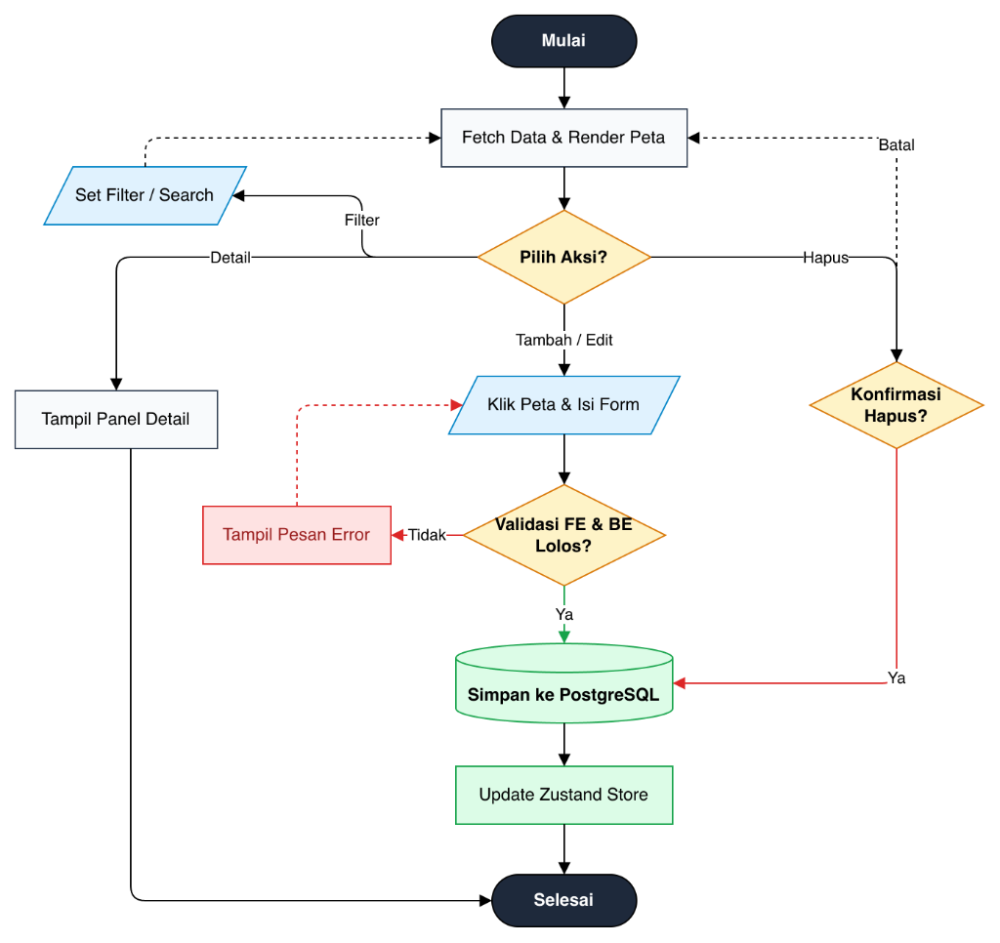
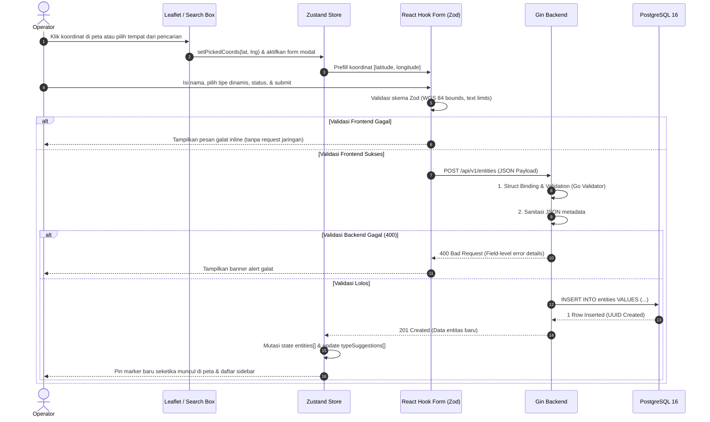
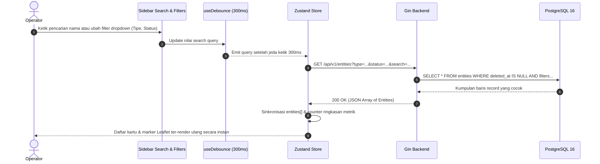
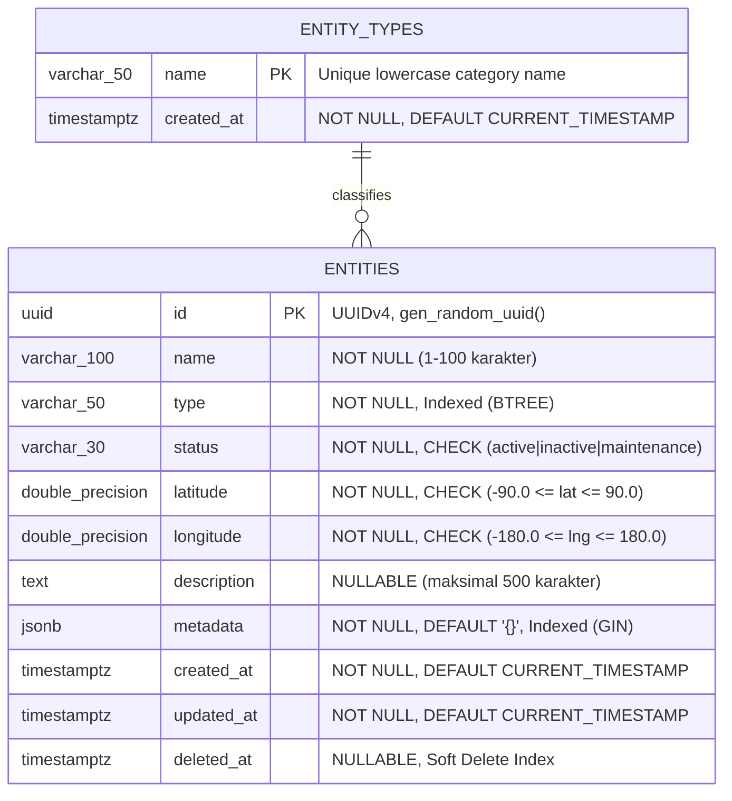
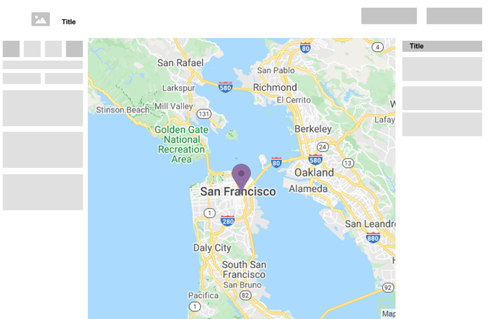

# Arsitektur Sistem & Spesifikasi Teknis: Geo Entity Manager

Dokumen ini memuat dokumentasi arsitektur komprehensif, diagram sekuens interaksi data, pemodelan basis data relasional (ERD), aturan tata kelola geospasial, serta standar desain antarmuka untuk platform **Geo Entity Manager**.

---

## 1. Arsitektur Tingkat Tinggi (High-Level Architecture)

Aplikasi dibangun dengan arsitektur modular yang memisahkan tanggung jawab secara tegas (*Separation of Concerns*) antara visualisasi geospasial, antarmuka pengguna, layanan backend Go/Gin, dan basis data PostgreSQL.

```text
┌─────────────────────────────────────────────────────────────────────────────┐
│                             CLIENT (BROWSER)                                │
│                                                                             │
│  React 18 + TypeScript + Vite                                               │
│  ├── Leaflet Map Canvas (Custom SVG Markers, Nominatim Place Search)        │
│  ├── Unified State Management: Zustand (Single Source of Truth)             │
│  ├── Form Management: React Hook Form + Zod Validation Schema               │
│  └── UI Primitives: shadcn/ui (Radix Primitives) + Tailwind CSS             │
└──────────────────────────────────────┬──────────────────────────────────────┘
                                       │
                      HTTP / JSON (RESTful API, Port 8080)
                                       │
┌──────────────────────────────────────▼──────────────────────────────────────┐
│                           API GATEWAY / BACKEND                             │
│                                                                             │
│  Go (Golang 1.22+) + Gin Web Framework                                      │
│  ├── Router & Middleware: CORS, Recovery, Structured Logger                 │
│  ├── Handlers (Controllers): Request Binding & Error Formatting             │
│  ├── Validation Engine: go-playground/validator/v10                         │
│  ├── Repository Layer: Domain Abstraction & Data Access Logic               │
│  └── ORM: GORM + gorm.io/datatypes (JSONB Support)                          │
└──────────────────────────────────────┬──────────────────────────────────────┘
                                       │
                      TCP / PostgreSQL Protocol (Port 5432)
                                       │
┌──────────────────────────────────────▼──────────────────────────────────────┐
│                               DATABASE LAYER                                │
│                                                                             │
│  PostgreSQL 16 Alpine                                                       │
│  ├── Primary Table: entities (UUID PK, Spatial Coordinates, JSONB Metadata)  │
│  ├── Database Constraints: CHECK on status, latitude, longitude             │
│  └── Production Indexes: B-Tree (Coordinates, Type, Status) & GIN (Metadata)│
└─────────────────────────────────────────────────────────────────────────────┘
```

---

## 2. Diagram Alur Sistem

### 2.1. Alur Logika Keseluruhan (Application Flowchart)



### 2.2. Alur Pembuatan Entitas (Map-Click / Place Search $\rightarrow$ Persistensi)



### 2.3. Alur Pencarian & Multi-Filter Reaktif (Debounced Query)



---

## 3. Pemodelan Basis Data & ERD (Entity Relationship Diagram)

Sistem menggunakan tabel `entities` untuk menampung seluruh atribut objek geospasial serta tabel `entity_types` untuk katalog kategori tipe dinamis pada basis data PostgreSQL 16:



---

## 4. Standar Data Geospasial

1. **Sistem Referensi Koordinat (CRS):**
   * Menggunakan standar global **WGS 84 (EPSG:4326)**, standar yang sama yang digunakan oleh satelit GPS dan Google Maps.
2. **Konsistensi Urutan Koordinat:**
   * Seluruh lapisan aplikasi secara konsisten menggunakan urutan **`[Latitude, Longitude]`** untuk mencegah kebingungan dengan format alternatif seperti GeoJSON `[Longitude, Latitude]`.
3. **Validasi Batas Geodetik (Boundary Guards):**
   * **Latitude (Garis Lintang):** $-90.0 \le \text{lat} \le 90.0$ derajat.
   * **Longitude (Garis Bujur):** $-180.0 \le \text{lng} \le 180.0$ derajat.
   * Nilai koordinat di luar rentang ini secara otomatis ditolak baik oleh skema Zod di sisi klien maupun oleh constraint database PostgreSQL `chk_entities_latitude` dan `chk_entities_longitude`.

---

## 5. Tata Kelola Antarmuka (UI/UX Governance)

### 5.1. Wireframe Tata Letak Dashboard (UI Layout)



Tata letak antarmuka mengadopsi arsitektur 3-kolom terintegrasi:
* **Top Bar (Navbar):** Memuat judul aplikasi dan tombol aksi utama (*Tambah Entitas* serta *Pilih Titik di Peta*).
* **Sidebar Kiri (Navigation & Filter):** Memuat kartu ringkasan status operasional (*Total, Active, Maintenance, Inactive*), kotak pencarian langsung, filter ganda (tipe dinamis & status), serta daftar kartu entitas yang dapat di-scroll.
* **Kanvas Peta Tengah (Map Viewport):** Peta interaktif Leaflet dengan marker pin lokasi, kontrol zoom, kotak pencarian geocoding (Nominatim), serta deteksi klik koordinat.
* **Drawer Kanan (Detail Sheet):** Panel samping non-modal yang muncul saat entitas dipilih untuk mengeksplorasi atribut teknis dan metadata JSONB tanpa menghalangi navigasi peta.

### 5.2. Prinsip Desain Antarmuka

Aplikasi mengadopsi standar desain modern berbasis pedoman ketat yang diverifikasi otomatis melalui linter arsitektur UI (`scripts/check-ui-guidelines.mjs`):

1. **Pemberantasan Warna Mentah (*Zero Raw Colors*):**
   * Tidak ada kode warna bawaan Tailwind mentah (`bg-gray-100`, `text-slate-800`). Seluruh warna permukaan, teks, dan batas mengacu pada **Semantic Theme Tokens** berbasis HSL (`bg-background`, `text-foreground`, `border-border`, `bg-card`).
2. **Estetika Garis Bersih (*Border-Only Lines*):**
   * Badge status dan kartu metrik menggunakan batas garis luar yang rapi (*border-only*) dipadukan dengan *status indicator dot* untuk kontras visual yang jelas dan terstruktur.
3. **Inspeksi Non-Modal Tanpa Blur:**
   * Drawer detail inspeksi di sisi kanan bersifat *non-modal* tanpa overlay hitam/blur, memungkinkan pengguna tetap menggeser peta (*pan*), memperbesar tampilan (*zoom*), atau memilih marker lain sambil meninjau rincian entitas.
4. **Kartu Flat Tanpa Drop-Shadow (*shadow-none*):**
   * Kotak rincian informasi di panel detail menggunakan kartu *flat* dengan `shadow-none` agar secara psikologi antarmuka (*affordance*) tidak membingungkan pengguna seolah-olah dapat diklik seperti tombol.
5. **Pengendalian Jarak dari Parent (*No Outer Margins*):**
   * Komponen reusable tidak membawa margin luar (`m-*`, `mt-*`, `mb-*`). Tata letak dan jarak sepenuhnya dikendalikan oleh container induk menggunakan `gap-*` atau `space-y-*`.

---

## 6. Daftar Variabel Lingkungan (.env Reference)

| Variabel | Tipe Data | Nilai Default | Deskripsi Fungsional |
| :--- | :--- | :--- | :--- |
| `PORT` | Integer | `8080` | Port listen server HTTP backend Go |
| `GIN_MODE` | String | `release` | Mode operasional Gin (`debug` / `release`) |
| `DB_HOST` | String | `postgres` / `localhost` | Host jaringan basis data PostgreSQL |
| `DB_PORT` | Integer | `5432` | Port layanan basis data PostgreSQL |
| `DB_USER` | String | `postgres` | Nama pengguna autentikasi database |
| `DB_PASSWORD` | String | `postgres` | Kata sandi autentikasi database |
| `DB_NAME` | String | `geo_entity_db` | Nama database utama |
| `DB_SSLMODE` | String | `disable` | Pengaturan enkripsi SSL koneksi database |
| `VITE_API_BASE_URL` | URL String | `http://localhost:8080/api/v1` | Base URL endpoint backend yang dikonsumsi oleh frontend |

