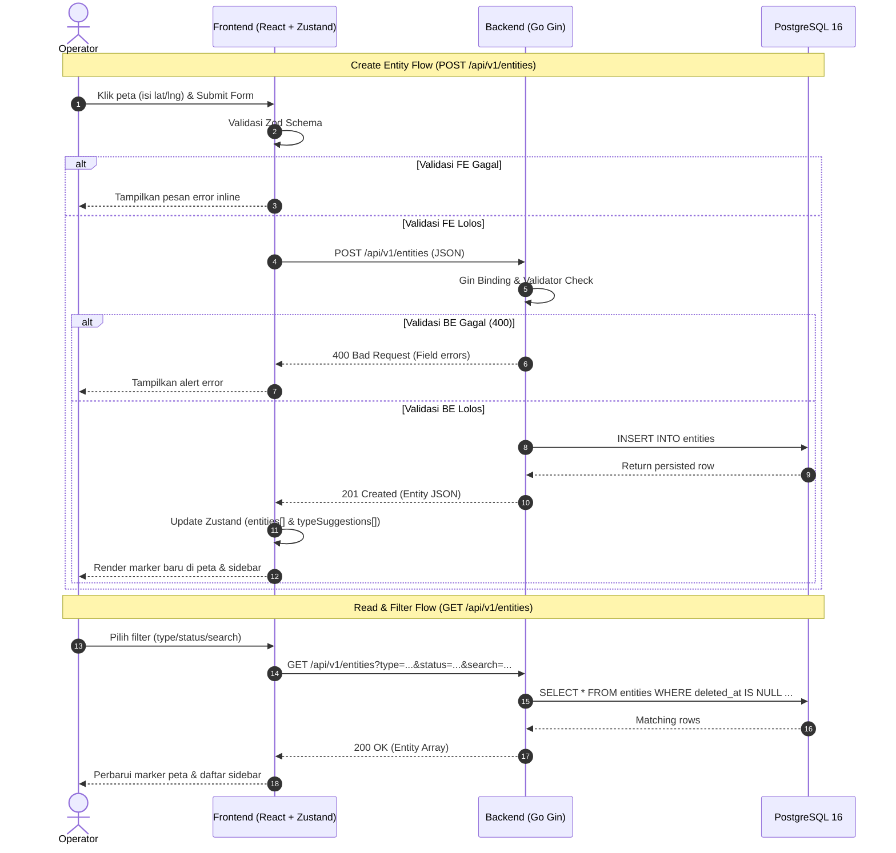

# Product Requirements Document (PRD): Geo Entity Manager

## 1. Ringkasan Proyek & Tujuan
**Geo Entity Manager** adalah aplikasi web untuk memvisualisasikan dan mengelola objek bergeolokasi (kendaraan, perangkat IoT, fasilitas) pada peta interaktif.

**Sasaran Teknis Utama:**
* **Validasi Ganda:** Rentang koordinat ($-90 \le \text{lat} \le 90$, $-180 \le \text{lng} \le 180$) divalidasi di Frontend (Zod) dan Backend (Go Validator).
* **Tipe Entitas Dinamis:** Pengguna dapat memilih saran tipe yang ada atau mengetik kategori baru tanpa migrasi skema database.
* **Map-Click Picker:** Klik langsung pada peta untuk mengisi otomatis titik koordinat pada form.

---

## 2. Prioritas Fitur (MoSCoW)

| Kategori | Fitur | Deskripsi Singkat |
| :--- | :--- | :--- |
| **Must Have** | Interactive Map & Markers | Render entitas di atas peta Leaflet dengan ikon berdasarkan tipe. |
| **Must Have** | Map-Click Coordinate Picker | Klik kanvas peta untuk injeksi nilai `latitude` & `longitude` ke form. |
| **Must Have** | Dynamic Entity Typing | *Combobox/datalist* saran tipe (`vehicle`, `iot_device`, `facility`) + input tipe baru. |
| **Must Have** | Full Entity CRUD | Tambah, lihat detail, perbarui, dan hapus entitas (*soft-delete*). |
| **Must Have** | Dual Validation | Validasi skema di Frontend (Zod) & Backend (`go-playground/validator`). |
| **Must Have** | Search & Multi-Filter | Filter berdasarkan `type`, `status`, dan pencarian `name`. |
| **Should Have** | Dockerized Stack | Orkestrasi satu perintah (`docker compose up --build`). |
| **Should Have** | JSONB Metadata | Penyimpanan atribut kustom per entitas di PostgreSQL. |
| **Won't Have** | Auth / RBAC & Live Socket | Di luar cakupan versi 1 (v1). |

---

## 3. Tech Stack & Struktur Direktori

### 3.1. Matriks Teknologi
| Lapisan | Teknologi |
| :--- | :--- |
| **Frontend** | React 18+, TypeScript, Vite, Tailwind CSS, `shadcn/ui` |
| **Map & State** | Leaflet, `react-leaflet`, **Zustand**, Axios |
| **Form & Validasi FE** | React Hook Form, Zod |
| **Backend** | Go 1.22+, Gin (`gin-gonic/gin`), GORM (`gorm.io/gorm`), `go-playground/validator/v10` |
| **Database** | PostgreSQL 16 Alpine |
| **Unit Testing** | Jest (Frontend) & Go `testing` + `httptest` (Backend) |

### 3.2. Struktur Repositori
```text
.
├── backend-entity-service/
│   ├── cmd/server/main.go            # Entrypoint binary & wiring
│   └── internal/                     # Private Go packages
│       ├── config/                   # 12-factor env configuration
│       ├── database/                 # Postgres connection, migrate, seed
│       ├── models/                   # GORM entities, DTOs, validation tags
│       ├── repository/               # Data access layer (GORM queries)
│       ├── handlers/                 # Gin controllers (HTTP context & response)
│       ├── server/                   # HTTP server lifecycle, routes, CORS
│       └── validator/                # Validation error message formatter
├── frontend-entity-service/
│   ├── src/
│   │   ├── api/                      # Axios instance & HttpEntityRepository
│   │   ├── components/
│   │   │   ├── ui/                   # 11 Primitif atomik shadcn/ui murni
│   │   │   ├── shared/               # Wrapper komposisi (Modal, FormField, StatCard)
│   │   │   ├── layout/               # Navbar & header
│   │   │   ├── entity/               # Fitur entitas (Sidebar, Card, DetailSheet, Form)
│   │   │   └── map/                  # Kanvas Leaflet, toolbar, marker, search
│   │   ├── store/useEntityStore.ts   # Single source of truth Zustand store
│   │   ├── schemas/                  # Zod validation schemas & tests
│   │   ├── types/entity.ts           # Domain models, ApiResponse<T>, Repository<T>
│   │   └── lib/                      # utils.ts (cn), mapIcons.ts (SVG DivIcon)
│   └── scripts/check-ui-guidelines.mjs # Linter otomatis aturan desain UI
├── docs/                             # PRD, arsitektur teknis, & requirement
│   ├── prd.md
│   ├── architecture.md
│   ├── agent.md
│   └── take-home.txt
├── AGENTS.md
├── LICENSE
├── docker-compose.yml
├── .env.example
├── .gitignore
└── README.md
```

---

## 4. Spesifikasi Teknis: Database, Flowchart, Sequence & API

### 4.1. Skema Database (`entities`)

| Kolom | Tipe Data | Constraint | Default | Deskripsi |
| :--- | :--- | :--- | :--- | :--- |
| `id` | `UUID` | `PRIMARY KEY` | `gen_random_uuid()` | Identitas unik entitas |
| `name` | `VARCHAR(100)` | `NOT NULL` | - | Nama objek (1-100 karakter) |
| `type` | `VARCHAR(50)` | `NOT NULL` | - | Kategori dinamis (`vehicle`, `iot_device`, dll.) |
| `status` | `VARCHAR(30)` | `NOT NULL`, `CHECK` | `'active'` | `active`, `inactive`, `maintenance` |
| `latitude` | `DOUBLE PRECISION` | `NOT NULL`, `CHECK` | - | Rentang [-90.0 .. 90.0] |
| `longitude` | `DOUBLE PRECISION` | `NOT NULL`, `CHECK` | - | Rentang [-180.0 .. 180.0] |
| `description` | `TEXT` | `NULL` | `NULL` | Catatan opsional (maks 500 karakter) |
| `metadata` | `JSONB` | `NOT NULL` | `'{}'::jsonb` | Atribut tambahan fleksibel |
| `created_at` | `TIMESTAMPTZ` | `NOT NULL` | `CURRENT_TIMESTAMP` | Waktu pembuatan (UTC) |
| `updated_at` | `TIMESTAMPTZ` | `NOT NULL` | `CURRENT_TIMESTAMP` | Waktu pembaruan (UTC) |
| `deleted_at` | `TIMESTAMPTZ` | `NULL` | `NULL` | Penanda *soft-delete* |

```sql
CREATE TABLE IF NOT EXISTS entities (
    id UUID PRIMARY KEY DEFAULT gen_random_uuid(),
    name VARCHAR(100) NOT NULL,
    type VARCHAR(50) NOT NULL,
    status VARCHAR(30) NOT NULL DEFAULT 'active' CHECK (status IN ('active', 'inactive', 'maintenance')),
    latitude DOUBLE PRECISION NOT NULL CHECK (latitude >= -90.0 AND latitude <= 90.0),
    longitude DOUBLE PRECISION NOT NULL CHECK (longitude >= -180.0 AND longitude <= 180.0),
    description TEXT NULL,
    metadata JSONB NOT NULL DEFAULT '{}'::jsonb,
    created_at TIMESTAMPTZ NOT NULL DEFAULT CURRENT_TIMESTAMP,
    updated_at TIMESTAMPTZ NOT NULL DEFAULT CURRENT_TIMESTAMP,
    deleted_at TIMESTAMPTZ NULL
);

CREATE INDEX IF NOT EXISTS idx_entities_type ON entities(type);
CREATE INDEX IF NOT EXISTS idx_entities_status ON entities(status);
CREATE INDEX IF NOT EXISTS idx_entities_coordinates ON entities(latitude, longitude);
CREATE INDEX IF NOT EXISTS idx_entities_metadata ON entities USING GIN (metadata);
CREATE INDEX IF NOT EXISTS idx_entities_deleted_at ON entities(deleted_at);

CREATE TABLE IF NOT EXISTS entity_types (
    name VARCHAR(50) PRIMARY KEY,
    created_at TIMESTAMPTZ NOT NULL DEFAULT CURRENT_TIMESTAMP
);
```

### 4.2. Application Flowchart (Alur Logika Sistem)


### 4.3. System Workflow (Sequence Diagram)



### 4.4. Wireframe & Tata Letak Antarmuka (UI Layout)


* **Top Bar (Navbar):** Brand aplikasi, tombol *Pilih Titik di Peta*, dan tombol utama *Tambah Entitas*.
* **Sidebar Kiri:** Kartu metrik status (*Total, Active, Maint., Inactive*), live search bar, filter tipe & status, serta scrollable list kartu entitas.
* **Tengah (Map Canvas):** Peta interaktif Leaflet dengan marker dinamis dan toolbar pencarian lokasi Nominatim.
* **Kanan (Detail Drawer):** Slide-over sheet non-modal untuk inspeksi rincian koordinat, deskripsi, dan metadata JSON atribut entitas terpilih.

### 4.5. Spesifikasi Endpoint REST API

**Base URL:** `/api/v1`

| Method | Endpoint | Deskripsi | Status Sukses | Status Gagal |
| :--- | :--- | :--- | :--- | :--- |
| `GET` | `/health` | Cek status server & koneksi DB | `200 OK` | `500` |
| `GET` | `/entities` | Daftar entitas (Query: `type`, `status`, `search`) | `200 OK` | `400`, `500` |
| `GET` | `/entities/types` | Daftar unik kategori `type` untuk *suggestion* | `200 OK` | `500` |
| `DELETE` | `/entities/types/{type}` | Hapus kategori `type` yang tidak sedang dipakai entitas aktif | `200 OK` | `400`, `409`, `500` |
| `GET` | `/entities/{id}` | Detail satu entitas berdasarkan UUID | `200 OK` | `404`, `500` |
| `POST` | `/entities` | Buat entitas baru | `201 Created` | `400`, `500` |
| `PUT` | `/entities/{id}` | Perbarui data entitas | `200 OK` | `400`, `404`, `500` |
| `DELETE` | `/entities/{id}` | Hapus entitas (*soft-delete*) | `200 OK` | `404`, `500` |

#### Contoh Request Body (`POST` / `PUT`):
```json
{
  "name": "Sensor Kualitas Udara - Bundaran HI",
  "type": "iot_sensor",
  "status": "active",
  "latitude": -6.1950002,
  "longitude": 106.8230005,
  "description": "Sensor PM2.5 real-time",
  "metadata": {
    "firmware": "v2.1.0",
    "battery_powered": true
  }
}
```

#### Contoh Response Sukses (`200 OK` / `201 Created`):
```json
{
  "success": true,
  "message": "Operation successful",
  "data": {
    "id": "7fa84e2a-19c2-4eb5-8e11-f1dbba8e68cf",
    "name": "Sensor Kualitas Udara - Bundaran HI",
    "type": "iot_sensor",
    "status": "active",
    "latitude": -6.1950002,
    "longitude": 106.8230005,
    "description": "Sensor PM2.5 real-time",
    "metadata": {
      "firmware": "v2.1.0",
      "battery_powered": true
    },
    "created_at": "2026-10-28T16:15:30Z",
    "updated_at": "2026-10-28T16:15:30Z"
  }
}
```

#### Contoh Response Error Validasi (`400 Bad Request`):
```json
{
  "success": false,
  "error": {
    "code": "VALIDATION_FAILED",
    "message": "Input validation failed on request body",
    "details": [
      {
        "field": "latitude",
        "issue": "latitude must be between -90.0 and 90.0"
      },
      {
        "field": "type",
        "issue": "type is required and length must be between 2 and 50 characters"
      }
    ]
  }
}
```

---

## 5. Kebutuhan Fungsional & Non-Fungsional

### 5.1. Functional Requirements (FR)
* **FR-01:** Render marker di peta sesuai koordinat WGS 84 dengan *fallback icon* otomatis untuk tipe kustom baru.
* **FR-02:** Input `type` pada form mendukung pemilihan dari daftar saran (`GET /entities/types`) maupun pengetikan teks baru.
* **FR-03:** Klik pada peta langsung memperbarui nilai `latitude` dan `longitude` pada form.
* **FR-04:** Operasi CRUD memperbarui tampilan peta dan sidebar secara reaktif melalui Zustand store.
* **FR-05:** Validasi batas nilai koordinat, panjang karakter nama (`1-100`), panjang tipe (`2-50`), dan enum status berjalan identik di FE dan BE.

### 5.2. Non-Functional Requirements (NFR)
* **NFR-01:** Waktu respon endpoint pembacaan daftar entitas $< 50\text{ ms}$ (untuk $< 100$ baris).
* **NFR-02:** Penghapusan menggunakan mekanisme *soft-delete* (`deleted_at`).
* **NFR-03:** Unit test wajib lulus 100% pada skema Zod (Jest) dan handler HTTP Go (`httptest`).

---

## 6. Milestones Pengerjaan

| Milestone | Fokus Pengerjaan | Kriteria Selesai (DoD) |
| :--- | :--- | :--- |
| **M1** | Setup Repo, Docker Postgres, Koneksi GORM & `/health` | Container DB jalan, `GET /api/v1/health` merespon `200 OK`. |
| **M2** | Backend CRUD, Endpoint `/types`, Validasi & Seeding | Seluruh 7 endpoint berfungsi dan memvalidasi input dengan benar. |
| **M3** | Unit Testing Backend | `go test ./...` pada `entity_test.go` lulus 100%. |
| **M4** | Setup Frontend, Zustand Store & Visualisasi Peta Leaflet | Marker dari database tampil di peta & daftar sidebar. |
| **M5** | Form Modal (Dynamic Type), Klik Peta, Detail & Delete | Alur tambah/edit via klik peta dan hapus data berjalan lancar. |
| **M6** | Unit Testing Frontend (Jest) & Full Docker Compose | `npm test` lulus & `docker compose up --build` menjalankan semua service. |
| **M7** | Dokumentasi Final | `README.md`, `docs/architecture.md`, dan `docs/agent.md` lengkap sesuai instruksi soal. |

---

## 7. Mitigasi Risiko Teknis
* **Koordinat Tertukar (Lat/Lng vs Lng/Lat):** Seluruh kontrak API, state Zustand, dan komponen Leaflet distandarisasi menggunakan urutan `[latitude, longitude]`.
* **Sinkronisasi UI:** Menggunakan satu *store* `useEntityStore.ts` sebagai *single source of truth* untuk peta dan sidebar.